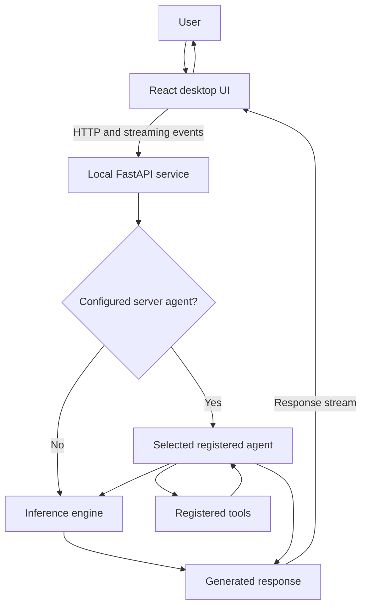

<h1 id="project-header" align="center">SONIC 2.0</h1>

<p align="center"><strong>Your Personal AI. Your Intelligence. Your Control.</strong></p>

<p align="center">A desktop personal AI assistant with a configurable agent runtime and local model support.</p>

<p align="center">
  <a href="https://github.com/prince78bhaskar/SONIC_2.0"></a>
  
  
  
  
  
  
  
</p>

<p align="center">
  <a href="https://github.com/prince78bhaskar/SONIC_2.0">Repository</a> ·
  <a href="https://github.com/prince78bhaskar">Author profile</a>
</p>

> **Implementation status:** This README describes the code present in this repository. The desktop product is labeled SONIC, but some Python package, command, and release identifiers have not yet been aligned to SONIC 2.0. The documented features below are limited to behavior and modules found in the checkout.

## SONIC 2.0 Demo

<div align="center">
  
</div>

## Table of Contents

1. [Project Header](#project-header)
2. [SONIC 2.0 Demo](#sonic-20-demo)
3. [About SONIC 2.0](#about-sonic-20)
4. [Project Vision](#project-vision)
5. [Key Features](#key-features)
6. [Multi-Agent Architecture](#multi-agent-architecture)
7. [How SONIC Works](#how-sonic-works)
8. [Technology Stack](#technology-stack)
9. [Project Architecture](#project-architecture)
10. [Project Directory Structure](#project-directory-structure)
11. [Installation and Setup](#installation-and-setup)
12. [Environment Configuration](#environment-configuration)
13. [Running the Project](#running-the-project)
14. [AI Model Configuration](#ai-model-configuration)
15. [Agent System](#agent-system)
16. [API Documentation](#api-documentation)
17. [Database and Data Persistence](#database-and-data-persistence)
18. [User Interface](#user-interface)
19. [Screenshots / Demo](#screenshots-demo)
20. [Future Scope](#future-scope)
21. [Development and Contribution](#development-and-contribution)
22. [Author](#author)
23. [License](#license)

## About SONIC 2.0

SONIC 2.0 is a personal AI assistant project presented as a desktop application. In this checkout, a React interface runs inside a Tauri desktop shell and talks to a local Python API service. The service can use Ollama and other configured inference engines, and can run a configured agent with tools.

The repository contains a broad assistant runtime. This README describes the current integration points rather than implying that every optional connector, model provider, or agent is enabled by default.

## Project Vision

SONIC 2.0 aims to give one person a configurable assistant they can run and manage from their own desktop. The direction is to make model choice, agent behavior, personal context, and stored conversation data understandable and user-controlled.

A single always-on master agent, automatic agent-to-agent collaboration, synchronized cloud history, and a complete voice-first workflow are not established as default SONIC features in the current code. They remain design goals or follow-up work where noted below.

## Key Features

| Capability | Current implementation |
|---|---|
| Desktop application | Tauri 2 shell with a React desktop interface. |
| AI conversations | Chat requests use a chat-completion API and can stream responses to the UI. |
| Local inference | An Ollama engine integration is present. Ollama and a model must be available for local inference. |
| Other model providers | Additional engine adapters exist; the chosen provider depends on configuration and credentials. |
| Agent runtime | A registry includes several agent implementations. The API uses a configured server agent when available, and can call the model directly otherwise. |
| Tools and managed agents | Tool execution and optional managed-agent lifecycle/message endpoints are implemented. They are not an automatic collaboration guarantee for every chat. |
| Conversation history | The desktop UI stores its chat list and settings in browser/WebView local storage. |
| Context and memory | Backend memory and context-injection paths are available when configured. They are not the same store as UI chat history. |
| Data and diagnostics | The interface includes agent, data-source, settings, dashboard, and log views; available integrations need their own setup. |
| Speech | Optional speech input/output components and API routes are present. A working voice setup depends on the selected speech provider and optional packages. |

## Multi-Agent Architecture

The current implementation has an agent registry and an optional configured server agent. It does **not** define one SONIC master agent that always classifies and delegates every user request. When an agent is configured, the chat API can pass work to it; otherwise, the server can use the selected model engine directly.

An agent may call its available tools and use their results during its own execution loop. The managed-agent API also exposes lifecycle and message operations for explicitly managed agents. The code does not imply that every chat agent shares memory or automatically coordinates with every other agent.

### Request flow

1. **Request handling:** the UI sends a chat-completion request to the local API.
2. **Agent path:** when a server agent is configured and the request is eligible, the server invokes that agent.
3. **Tool loop:** a tool-using agent asks the model for an action, executes a registered tool, returns the result to the model, and repeats until it has a final answer or reaches its configured limit.
4. **Direct path:** if there is no applicable server agent, the API sends the request to the configured inference engine.
5. **Response:** generated text and tool events stream back to the UI. The UI updates the message and displays tool status.
6. **Errors:** backend failures are returned through the API/stream; the UI records an error and presents available error detail. Automatic cross-agent recovery is not promised.

## How SONIC Works



The API also exposes optional memory, connector, telemetry, and managed-agent routes. Those capabilities depend on their configuration and are not implied by the basic chat path.

## Technology Stack

| Layer | Technologies verified in the repository |
|---|---|
| Desktop shell | Tauri 2, Rust |
| Frontend | React 19, TypeScript, Vite 8, Tailwind CSS |
| Backend | Python 3.10–3.13, FastAPI, Uvicorn |
| Inference | Ollama integration plus other configurable engine adapters |
| Persistence | SQLite-backed backend stores and browser local storage |
| Python dependency management | `uv` with `pyproject.toml` and `uv.lock` |
| Frontend dependency management | npm with `frontend/package-lock.json` |

There is no `requirements.txt`; Python dependencies and optional groups are declared in [`pyproject.toml`](./pyproject.toml). Frontend scripts and dependencies are declared in [`frontend/package.json`](./frontend/package.json).

## Project Architecture

- **Desktop shell:** Tauri hosts the web interface and manages local service startup.
- **Frontend:** React pages and components handle chat, settings, agents, data sources, logs, and dashboards.
- **API service:** FastAPI provides chat completions and supporting feature routes. The chat endpoint supports streaming.
- **Agent runtime:** registered agents implement different execution patterns. The server configuration determines whether a configured agent is used for a chat request.
- **Inference engines:** the Python runtime selects an engine and model based on configuration. Ollama is one supported local engine.
- **Tools and storage:** registered tools and optional memory, session, trace, and telemetry stores support configured workflows.

## Project Directory Structure

```text
.
├── README.md
├── pyproject.toml
├── uv.lock
├── Makefile
├── frontend/
│   ├── package.json
│   ├── package-lock.json
│   ├── src/                 # React pages, chat UI, API client, state
│   └── src-tauri/           # Active Tauri application
├── src/                     # Python API, agents, engines, tools, memory, connectors
├── rust/
│   ├── crates/              # Rust/Python integration and supporting crates
│   └── rust-toolchain.toml
├── desktop/                 # Additional desktop packaging sources
├── configs/                 # Runtime configuration and examples
├── assets/                  # Demo media and project assets
├── docs/                    # Project documentation
└── tests/                   # Python and frontend test suites
```

The current source checkout has both `frontend/src-tauri/` and `desktop/`; the npm/Tauri commands below use `frontend/src-tauri/`.

## Installation and Setup

### Prerequisites

- Git
- Python 3.10 through 3.13
- [`uv`](https://docs.astral.sh/uv/)
- Node.js 22.22 or newer and npm 11.19.x
- Rust 1.89 or a compatible toolchain, installed through `rustup`
- Tauri's Windows native build prerequisites when compiling the desktop app
- Ollama installed and running if you plan to use a local Ollama model

### Clone and install

Run these commands in PowerShell:

```powershell
git clone https://github.com/prince78bhaskar/SONIC_2.0.git
Set-Location SONIC_2.0

uv sync --extra desktop --group desktop-native

Set-Location frontend
npm ci
```

`uv sync` installs the Python desktop dependencies and the native Rust extension group used by the desktop runtime. `npm ci` installs the frontend dependencies from the checked-in lockfile.

## Environment Configuration

A root-level `.env.example` is not present. The desktop app's settings are configured through its UI; use the **Settings** page to select an inference source, model, and any provider credentials.

For a browser-only Vite development session, the frontend can read `VITE_API_URL`. If omitted, its development proxy targets `http://localhost:8000`.

```dotenv
VITE_API_URL=http://localhost:8000
```

Save that optional setting in `frontend/.env.local`. Do not commit API keys or other secrets. Desktop credentials are handled through the app's credential-storage integration where supported.

## Running the Project

### Desktop application (recommended source workflow)

From the `frontend` directory after installing dependencies:

```powershell
npm run tauri dev
```

The Tauri shell starts the Vite UI and manages the local API service. The backend starts on port `8000`.

### Browser frontend and backend separately

For browser-only UI development, start the API from the repository root in one PowerShell window:

```powershell
uv run jarvis serve --host 127.0.0.1 --port 8000
```

Then start Vite in another window:

```powershell
Set-Location frontend
npm run dev
```

The Python project currently exposes the server under the internal `jarvis serve` command. A SONIC-named command-line interface is not configured yet. `npm run dev` starts only the frontend; the API must already be reachable.

## AI Model Configuration

Choose an inference source and model in the desktop **Settings** page. The code includes an Ollama engine and supports other engine adapters, including configured API-compatible providers. Which providers are usable depends on installed optional dependencies, valid credentials, and a reachable model server.

For local inference, install and start Ollama, pull a model supported by the installed Ollama version, and select that model in SONIC. No specific model is hard-coded here because the source configuration and available models can vary by machine.

## Agent System

The registry includes agents with distinct execution patterns. Their availability depends on configuration and optional dependencies.

| Internal agent ID | Implemented behavior |
|---|---|
| `simple` | Single model call with no tool-calling loop. |
| `orchestrator` | Multi-turn model/tool loop; stops with a final answer or at its turn limit. |
| `native_react` | Thought/action/observation loop over the tools configured for the agent. |
| `deep_research` | Multi-hop retrieval and cited responses when the corresponding retrieval tools are available. |

- **Agent selection:** the backend can select an agent through its server configuration or the `--agent` server option. The selected agent applies to the API's chat path.
- **Master agent:** no dedicated SONIC master agent is configured as the universal request router.
- **Task routing:** the runtime does not automatically select among these agents with a universal intent classifier.
- **Communication:** managed-agent routes provide explicit lifecycle and messaging operations. Regular chat does not imply arbitrary agent-to-agent messaging.
- **Memory:** context injection is conditional on memory configuration. Agents do not automatically share a common memory store.
- **Errors:** API and tool failures are surfaced through server responses or stream events and logged by the interface; the README does not claim autonomous multi-agent recovery.

## API Documentation

The Python service is a FastAPI application. When it is running locally, the generated API reference is available at:

- Swagger UI: [`http://127.0.0.1:8000/docs`](http://127.0.0.1:8000/docs)
- OpenAPI schema: [`http://127.0.0.1:8000/openapi.json`](http://127.0.0.1:8000/openapi.json)

The main endpoints and route groups include:

| Route | Purpose |
|---|---|
| `GET /health` | Service health check. |
| `POST /v1/chat/completions` | Chat-completion request; supports streaming. |
| `GET /v1/models` | List models available through the configured inference engines. |
| `POST /v1/models/pull` | Request a model pull through supported local engine integrations. |
| `GET /v1/info` | Return server and engine information. |
| `/v1/agents` and `/v1/managed-agents` | Agent operations and managed-agent controls. |
| `/v1/memory`, `/v1/sessions`, `/v1/traces`, `/v1/telemetry` | Optional context, session, trace, and runtime measurement APIs. |
| `/v1/skills` | Skill-related API routes. |

The generated API schema is the source of truth for request fields and response models. Optional routes may depend on configuration and installed extras.

## Database and Data Persistence

SONIC uses more than one persistence mechanism in the current code:

- **Chat UI history and preferences:** browser/WebView `localStorage`. This data is local to that UI profile and is not a cloud-synced account history.
- **Backend data:** SQLite-backed stores are implemented for sessions and other optional runtime features such as memory, traces, and telemetry. The specific stores enabled depend on configuration.
- **External database service:** no PostgreSQL or MongoDB service is configured as a required project dependency.

Do not treat the UI conversation list and backend session or memory databases as one unified store. Back up the relevant application data separately if you need to preserve it.

## User Interface

The React interface includes chat, agent management, data-source configuration, settings, logs, and dashboard views. Chat responses stream into the conversation, and the UI can show tool activity and runtime information when the API provides it.

The interface is hosted in a Tauri desktop window. A browser development mode is also available through Vite, but it requires a running backend.

<a id="screenshots-demo"></a>

## Screenshots / Demo

The [demo reel above](#sonic-20-demo) is the only project demo media verified for this README. No separate SONIC-branded screenshot set was found in the repository.

## Future Scope

- Align the Python distribution, command-line interface, desktop identifiers, and release/update configuration with SONIC 2.0. The current desktop package version is `1.0.1`; see the [Tauri configuration](./frontend/src-tauri/tauri.conf.json).
- Decide whether SONIC should add a dedicated master agent and explicit intent-based agent routing.
- Define which managed agents should collaborate, what context they may share, and how failures should be recovered.
- Extend the optional speech components into a complete voice interaction workflow.
- Define a supported automation experience and its user controls.
- Publish SONIC-specific setup, API, and contribution guidance.
- Confirm project license and source attribution before distributing under the SONIC name.
- Add screenshots created specifically for the SONIC interface.

## Development and Contribution

The source workflow and commands above are verified against the checked-in project manifests. The repository does not yet include SONIC-specific contribution instructions.

For changes, use the [SONIC 2.0 repository](https://github.com/prince78bhaskar/SONIC_2.0) to open an issue or pull request. Please include a clear description of the change, setup requirements, and any manual verification performed.

## Author

**Prince Bhaskar**

- GitHub: [prince78bhaskar](https://github.com/prince78bhaskar)
- Project repository: [SONIC 2.0](https://github.com/prince78bhaskar/SONIC_2.0)

## License

No license has been confirmed for SONIC 2.0, so this README makes no license claim. Confirm the rights and applicable terms for the current repository before redistributing it.
